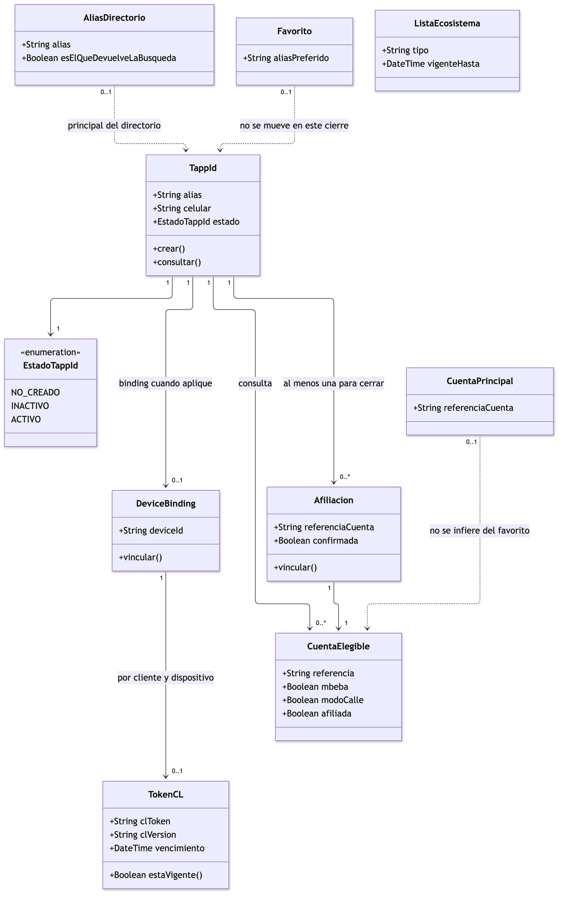

# Modelo de datos — TAPP onboarding y post-login

**26-nov-2026.** Dominio visto por Interbank. No hay esquema físico ni contrato de campos. Los atributos son nombres de dominio. Lo que la DHU prohíbe persistir no aparece como dato guardado.

Fuente: [tapp-onboarding-base-2026-11-26.md](../tapp-onboarding-base-2026-11-26.md). El diagrama editable está en [modelo-datos.mmd](modelo-datos.mmd).

## Qué significa cada pieza

| Pieza | Qué está cerrado | Qué no se dibuja como hecho |
|---|---|---|
| `TappId.estado` | Nace inactivo al crearlo. Sigue inactivo si el cliente regresa antes de afiliar. Pasa a activo con al menos una cuenta confirmada. Si ya existe, no se crea otro | El estado eliminado de la versión del 23-nov no está en la DHU de este paquete |
| `DeviceBinding` | El cierre exige binding vigente cuando aplique. Es distinto del dispositivo seguro del canal, que ya vive en el login | Dónde se guarda el binding |
| `TokenCL` | Se crea o se rota por cliente según token y versión. Vigencia usada en el diseño anterior: 30 días. Esta ronda no la repitió el deck | En qué base se guarda. Redis está confirmado solo para las listas |
| `CuentaElegible.mbeba` | `Y` pide el UPI PIN existente. `N` va a crearlo. El flag no reemplaza la prueba de que la cuenta está afiliada | — |
| `modoCalle` | Si la entidad es Interbank, solo se ofrece la cuenta que la respuesta marca en modo calle | — |
| `Afiliacion.confirmada` | El éxito de pantalla exige `SUCCESS` de esa cuenta. Sin confirmación el estado es pendiente o error | El API que persiste el vínculo está pendiente en la DHU |
| `AliasDirectorio` | Es el alias que el directorio devuelve al buscar por celular. La portabilidad lo cambia con `MODIFY` | La DHU no lo llama favorito |
| `Favorito` | Alias preferido del cliente. Este onboarding no lo crea ni lo cambia | Mecanismo pendiente |
| `CuentaPrincipal` | Cuenta que recibe los fondos. No sale del favorito ni cambia como efecto de afiliar | — |
| `ListaEcosistema` | PSP y proveedores. Dato global, TTL de una hora. El PAC las publica una vez al día | Clave de caché |

## Qué no entra al modelo persistido

Últimos 6 dígitos, fecha de vencimiento, clave de cajero y OTP. Viajan cifrados hacia el PAC y no se guardan. El estado con el que se retoma un flujo tampoco arrastra credenciales.

El Tapp ID, sus cuentas y el directorio los consulta Interbank. La base de Izipay y la del BCRP no se modelan aquí.
