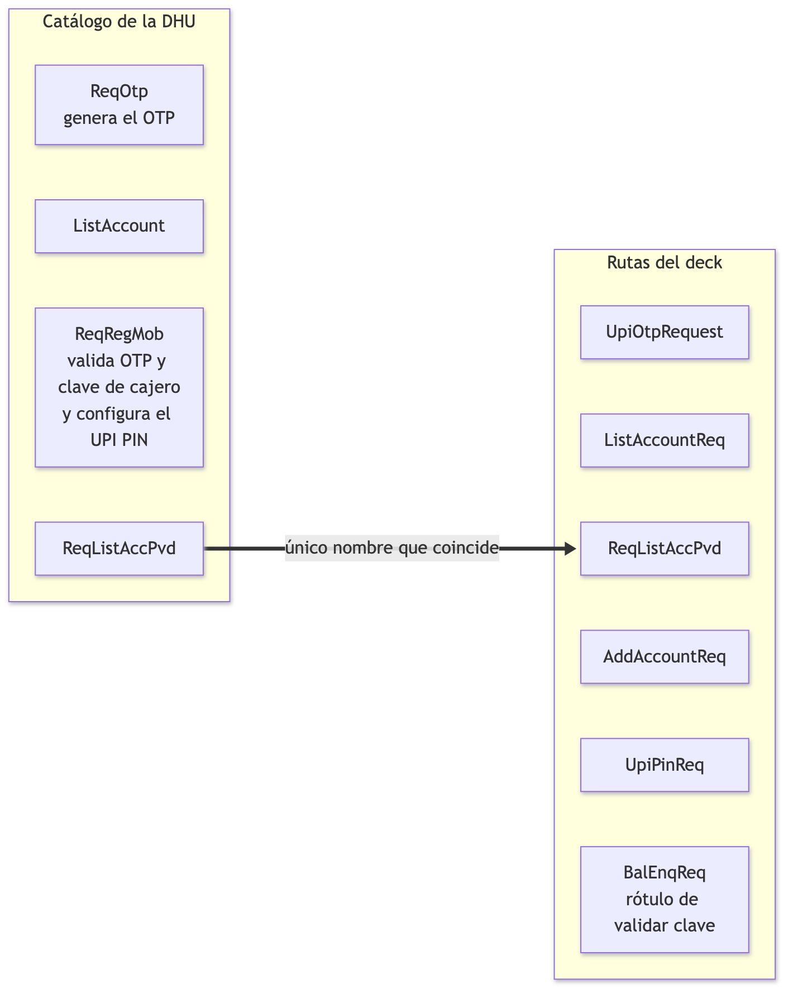
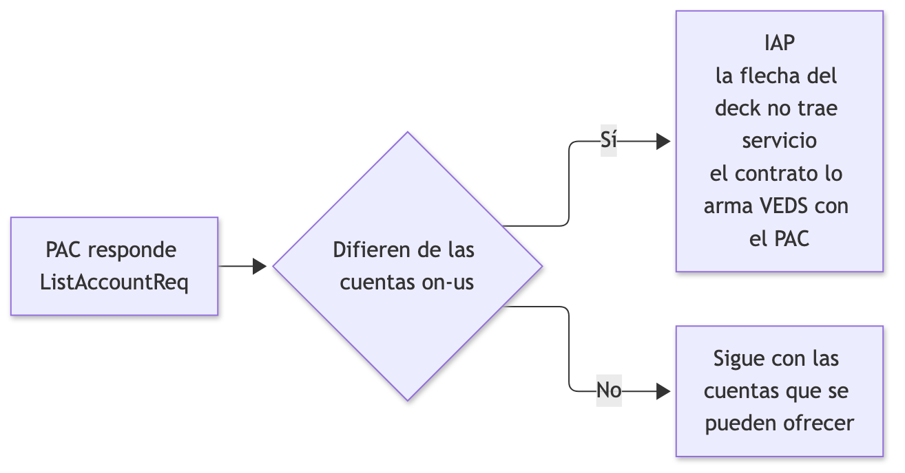
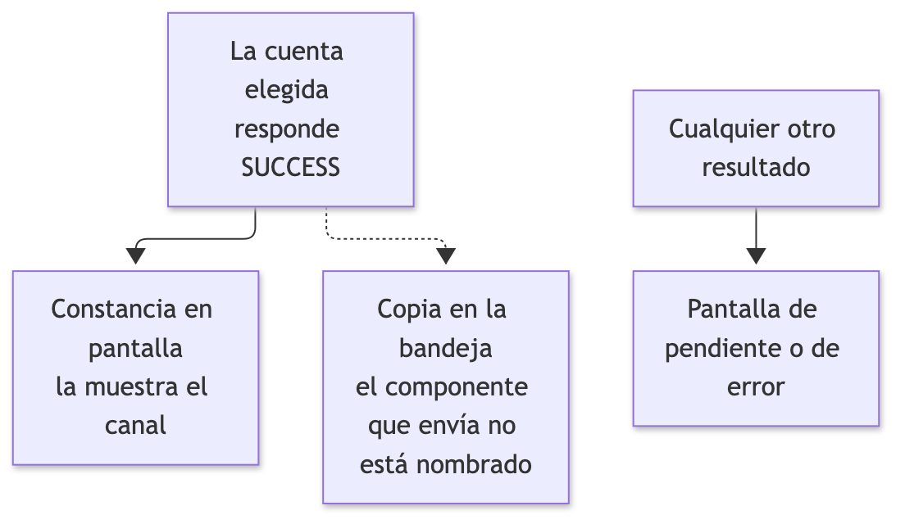
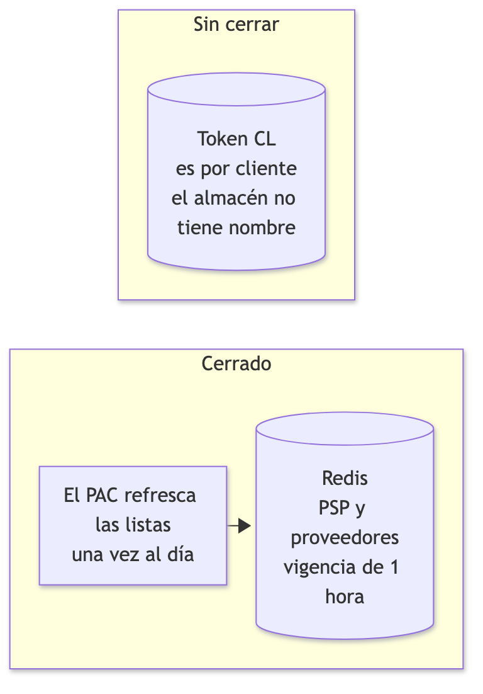
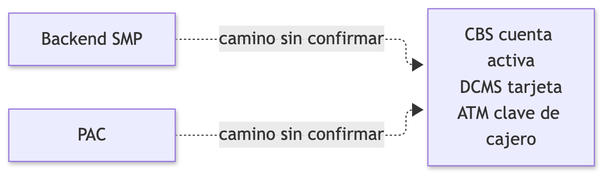
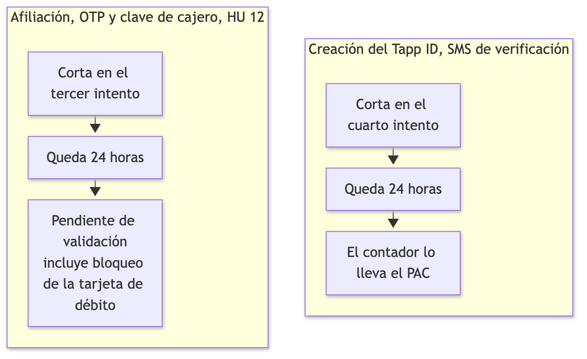
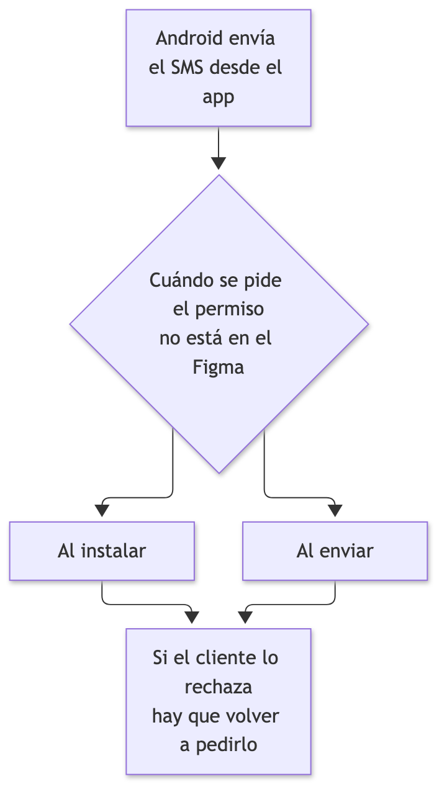
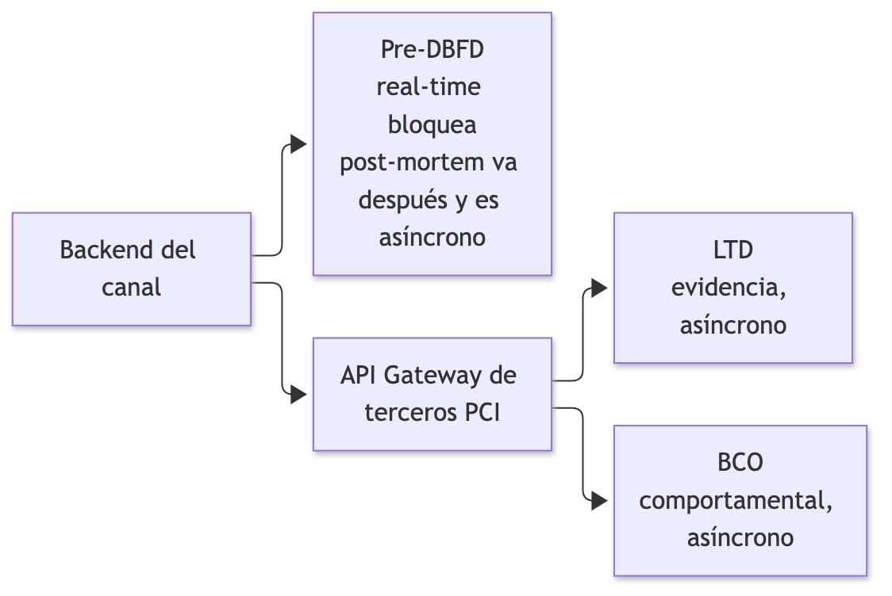
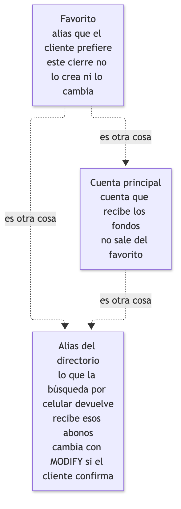
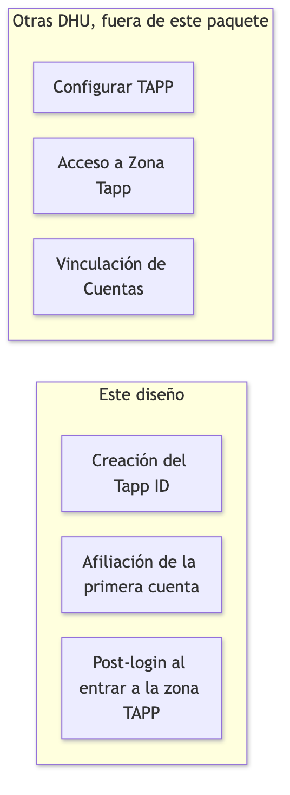

# Pendientes por cerrar — onboarding y post-login

**Interbank · 26-nov-2026**

Acompaña el diseño de esta carpeta. Cada punto es algo que las fuentes nombran y no cierran. En los diagramas quedó punteado, o se usó el nombre del deck mientras llega el mapeo.

Cerrar un punto cambia una flecha de punteada a sólida, o le pone el servicio que hoy no tiene. No cambia el alcance: post-login, creación del Tapp ID y afiliación de la primera cuenta.

## 1. Dos catálogos para las mismas llamadas

La DHU y el deck no hablan el mismo idioma de servicios. Las secuencias usan las rutas del deck. La DHU manda en el comportamiento de pantalla.

`ReqListAccPvd` es el único nombre que aparece igual en los dos lados. El resto está suelto a propósito.

| La DHU dice | Qué hace, según la historia | El deck dice |
|---|---|---|
| `ReqListAccPvd` | Entidades habilitadas | `ReqListAccPvd` |
| `ListAccount` | Cuentas de la entidad elegida | `ListAccountReq` |
| `ReqOtp` | Genera el OTP. El app no lo guarda ni lo reutiliza | `UpiOtpRequest` está en el paso de OTP, sin mapa firmado |
| `ReqRegMob` | Valida el OTP y la clave de cajero, y configura el UPI PIN | `AddAccountReq`, `UpiPinReq` y `BalEnqReq` cubren afiliar, crear clave y validar clave |

Hay que responder con una tabla de equivalencias firmada por quien tenga el contrato de Izipay. Hasta entonces no se renombran las secuencias.

## 2. El rótulo BalEnqReq

En la foto del deck, el paso «validar Clave Tapp» está rotulado `/service/BalEnqReq`. El nombre parece una consulta de saldo. En el gráfico anterior queda suelto, abajo a la derecha, con esa leyenda.

El diseño lo conservó como rótulo de la foto. Crear la clave sigue en `UpiPinReq`.

Hay que leerlo en el PDF original de `TAPP-Onboarding.pdf`, no en la foto. Si el PDF dice otra ruta, se cambia la secuencia de afiliación y nada más.

## 3. IAP no tiene servicio

Cuando las cuentas que devuelve el PAC no coinciden con las on-us de Interbank, el deck dibuja un aviso a IAP. La flecha no trae operación.

En la versión del 23-nov esa diferencia se cruzaba con la consulta integrada. El deck la saca de ahí. El contrato lo está armando VEDS con el PAC. En sala no se dijo el nombre del servicio.

Hace falta el nombre de la operación, quién la llama y qué se envía cuando hay diferencia. Mientras tanto la caja queda punteada y no se le inventa un contrato.

## 4. Quién envía la constancia a la bandeja

La HU 14 exige dos cosas juntas cuando la cuenta elegida responde `SUCCESS`: la constancia en pantalla y una copia en la bandeja del cliente. Si el resultado es otro, la pantalla es pendiente o error.

La pantalla la muestra el canal. La historia no nombra al componente que deja la copia en la bandeja. En la reunión, el correo de afiliación se lo atribuían al proveedor de cuentas. No está dicho que ese correo y la constancia de la bandeja sean el mismo envío, así que el diseño no dibuja una caja de notificaciones.

Hay que nombrar al emisor de la bandeja y decir si ese envío es el correo del proveedor o uno distinto.

## 5. Dónde se guarda el token CL

Las listas y el token no son el mismo dato. Las listas son del ecosistema. El token es del cliente.

Redis está cerrado: PSP y proveedores, vigencia de una hora, y el PAC las publica una vez al día. El token CL se crea o se rota por cliente. La versión del 23-nov lo ponía en una base del canal, cifrada. Esta ronda no lo confirmó ni lo movió. No se dibujó dentro de Redis.

Hay que decir en qué base vive, si va cifrado y cuánto dura. La vigencia de 30 días del diseño anterior no la repitió el deck.

## 6. Quién llama a CBS, DCMS y ATM

La HU 12, cuando la entidad es Interbank, separa tres validaciones: CBS mira que la cuenta esté activa, DCMS mira la tarjeta y ATM mira la clave de cajero. Validar la cuenta en CBS no afilia esa cuenta al Tapp ID. El deck no muestra esas llamadas.

Los dos caminos están punteados porque la historia no elige. Puede llamarlos el backend o puede hacerlo el PAC detrás de `ReqRegMob`. Dibujar los dos como hechos sería inventar el flujo.

Hay que decir quién llama a cada uno y en qué momento de la afiliación.

## 7. Hay dos bloqueos de 24 horas

Los dos duran un día y se parecen al contarlos en voz alta. Cortan cosas distintas.

El de creación es el SMS con el que se verifica el celular. En sala se dijo que el cuarto intento lo frena el PAC durante 24 horas.

El de la HU 12 es el de la afiliación: OTP y clave de cajero. Al tercer intento el onboarding queda bloqueado 24 horas. La historia lo marca pendiente de validación e incluye el bloqueo de la tarjeta de débito.

Hay que confirmar el de la HU 12, decir quién lleva ese contador y si el bloqueo de tarjeta es del mismo evento. El del SMS de creación ya tiene dueño: el PAC.

## 8. Largo de la Clave Tapp

El mock de «Ingresa tu Clave Tapp» pinta cuatro posiciones. En sala quedó abierto si son 4 o 6. No cambia las cajas ni las flechas.

`mbeba=Y` pide la clave que ya existe. `mbeba=N` la crea con `UpiPinReq`. Eso está cerrado y no depende del largo.

Hay que fijar el largo para el contrato y para la pantalla.

## 9. Permiso de SMS en Android

Android envía el SMS desde el app. iOS lo envía desde Mensajes, así que este permiso no le aplica. Android intenta leer el SIM; si no puede, el cliente escribe el número. iOS siempre lo escribe. Eso es el comportamiento ya dibujado en la creación.

El permiso es otra decisión. No está en el Figma.

Hay que decidir si se pide al instalar o al enviar, y qué pantalla ve el cliente si lo rechaza. La historia dice que, si lo rechaza, hay que volver a pedirlo.

## 10. Handoff entre canal, Pre-DBFD y BCO

El orden del deck sí está dibujado. El real-time de Pre-DBFD bloquea, en la creación antes del token y en la afiliación antes de listar cuentas. El post-mortem va después y es asíncrono. LTD y BCO también son asíncronos y salen por el API Gateway.

No hay flecha entre Pre-DBFD y BCO. En sala quedó abierta la duda de si BCO espera el resultado de Pre-DBFD y qué dato cruza entre canal, Pre-DBFD y BCO.

Hay que cerrar ese handoff. El orden de las llamadas ya no está en discusión.

## 11. Favorito, cuenta principal y alias del directorio

Tres frases de la sala se pisan. La DHU y el deck hablan de cosas distintas.

| Concepto | Quién lo define | Qué hace este cierre |
|---|---|---|
| Favorito | La DHU. Es el alias que el cliente prefiere | No lo crea y no lo cambia. El mecanismo sigue pendiente |
| Cuenta principal | La DHU. Es la cuenta que recibe los fondos | No se deduce del favorito y no cambia al afiliar |
| Alias del directorio | El deck y la reunión. Es lo que la búsqueda por celular devuelve, y recibe esos abonos | Se consulta con `CHECK`. Si la búsqueda devuelve otro alias, `PORT` y, si el cliente confirma, `MODIFY` |

En la reunión, «Tapp ID principal» es ese alias del directorio. La DHU no usa esa frase.

Hay que decir si `MODIFY` mueve solo el alias de la búsqueda, y dejar escrito que favorito y cuenta principal se administran en otra historia. El mecanismo del favorito sigue pendiente en la DHU.

## 12. Persistencia, errores y volumetría

Son cuatro cierres de documento. Ninguno cambia el dibujo de componentes hasta que llegue el dato.

| Pendiente | Qué dice la fuente | Qué se necesita |
|---|---|---|
| Vínculo cuenta a Tapp ID | La DHU marca el API como pendiente | La operación que persiste la relación y el momento en que pasa a `SUCCESS` |
| Estado contra el directorio | Está definido solo a nivel conceptual | Qué se guarda en canal y qué se vuelve a preguntar al directorio |
| Catálogo de errores | La HU 15 pide la matriz final. Check status y recovery están conceptuales. Los feature flags figuran como propuesta | La matriz código, mensaje, acción y recuperación. Las credenciales no viajan en ese estado |
| Volumetría del PAC | La premisa de diseño es 3 segundos por llamada no financiera | Las pruebas de performance. La premisa de 3 segundos se mantiene hasta que esas pruebas digan otra cosa |

## 13. Historias que este paquete no cubre

El diseño cubre la entrada a la zona, la creación del Tapp ID y la afiliación de la primera cuenta. Tres historias se nombran al lado y no vinieron en este PDF.

Acceso a Zona Tapp tiene el detalle de las validaciones mínimas de la entrada. Configurar TAPP cubre lo no financiero que no es este alta. Vinculación de Cuentas cubre las cuentas adicionales. Las cuentas adicionales y esas validaciones mínimas no se inventaron aquí.

Cuando esas DHU lleguen, se agregan al lado de este diseño. No se reabre la afiliación inicial para meterlas.
