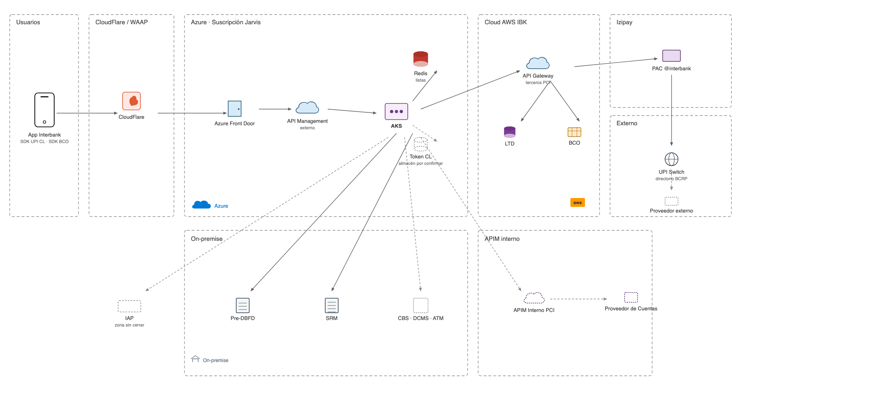
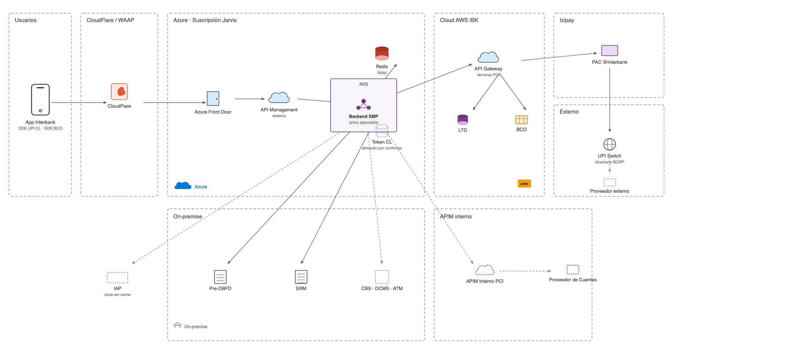

# TAPP Onboarding — Componentes (27-nov-2026)

Reemplaza, para este corte, los componentes del 26-nov. Las secuencias de esa fecha siguen vigentes: el nombre de cada operación vive ahí, no en estas cajas.

El alto nivel sigue la secuencia de zonas de `SMP-CLDIS-2025-PRD`: usuarios, CloudFlare / WAAP, Azure suscripción Jarvis, APIM interno y on-premise. AWS e Izipay siguen en esa lectura porque por ahí sale la llamada al PAC. No entran regiones, VNET, IP, VLAN, hostnames ni la granja de servidores.

En Jarvis el alto nivel deja la cadena del ejemplo: Azure Front Door, API Management externo y el clúster AKS. Backend SMP corre dentro de AKS y solo aparece al abrirlo. La fuente no nombra otro ejecutable en ese clúster.

Punteado, porque la fuente lo nombra y no cierra el contrato o la zona:

- Almacén del token CL. No es Redis.
- IAP. La zona no está dicha.
- CBS, DCMS y ATM. La historia 12 los nombra y no dice quién llama.
- APIM Interno PCI y Proveedor de Cuentas. Salen de la lámina 22 de hoy. `SyncCustomerAccounts` no está en las secuencias.
- Del UPI Switch al proveedor de cuenta externo. El camino no está cerrado.

Redis, Pre-DBFD, SRM, el API Gateway de terceros PCI, LTD, BCO, el PAC y el UPI Switch están en la base del 26-nov. Front Door, AKS, Service Bus y Key Vault no aparecen: este onboarding no los nombra.
