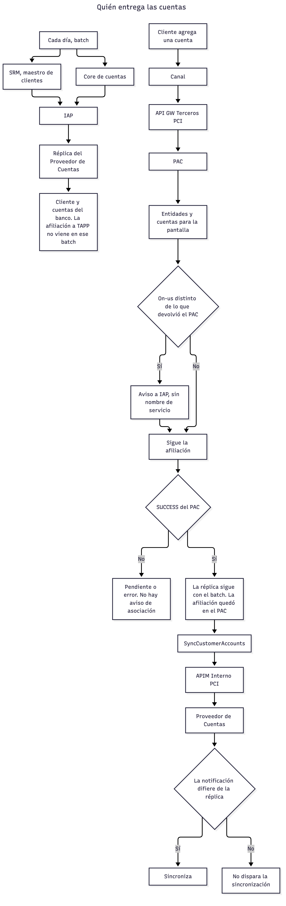
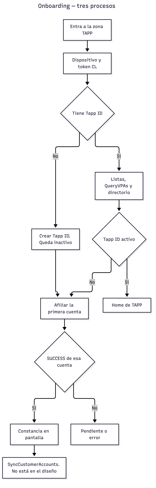

# Reunión 27-nov-2026 — Proveedor de Cuentas y onboarding

**Interbank · arquitectura de canal**
**Fuente:** `IMG_0281.MOV`, llamada Teams de hoy. Deck en pantalla: *UPI Proveedor de Cuentas - Arquitectura*, SharePoint. Transcripción parcial en `trabajo/transcripciones/img0281.md`. El audio de la sala salió bajo; la lámina 22 fija la modificación. El diseño de onboarding contra el que se compara está en [tapp-onboarding-base-2026-11-26.md](../tapp-onboarding-base-2026-11-26.md) y en [2026-11-26/diseno.md](../2026-11-26/diseno.md).

En la llamada: Díaz Cho, Carlos Moisés; Ponce Aguilar, José F.; José (canal).

## Qué pidieron

La lámina 17 muestra el menú Afiliación, Añadir Cuenta y Establecer PIN. La lámina 22, *Actualización de la réplica desde el canal IBK*, pide una llamada que el onboarding no tiene.

El canal (caja modificada) llama `SyncCustomerAccounts` por **APIM Interno PCI** al Proveedor de Cuentas (caja nueva). Adentro, la réplica recibe `syncCustomerAccounts` en punteado. La integración está marcada como nueva.

Texto de la lámina, como paso final de la asociación de cuenta:

- El canal avisa al Proveedor de Cuentas sobre el cliente y sus cuentas.
- El proveedor compara esa notificación con su réplica y, si hay diferencia, dispara la sincronización sin pegarle al performance.

En el audio, la réplica de hoy les llega en batch, una vez al día, desde SRM y desde el core de cuentas, hacia el IAP. En la sala se corrigió que si la cuenta quedó afiliada a TAPP no lo sabe el proveedor: ese dato se queda en el PCP. En el deck de onboarding ese rol es el PAC. Al cierre quedó dicho que la modificación se le podría hacer al IAP, y que hoy se confirma si es viable.

`SyncCustomerAccounts` no está en las secuencias de onboarding. El aviso a IAP que sí está dibujado es otra flecha: sin nombre de servicio, sale al listar cuentas cuando lo on-us no coincide con el PAC, y el contrato lo arma VEDS con el PAC. La lámina 22 nombra otra operación, otro destino, otra puerta y otro momento.

| | Aviso a IAP, diseño del 26-nov | `SyncCustomerAccounts`, lámina 22 |
|---|---|---|
| Destino | IAP | Proveedor de Cuentas |
| Puerta | Sin nombre. En sala, la conectividad canal–IAP ya estaba pedida | APIM Interno PCI |
| Momento | Al listar cuentas, si on-us y PAC difieren | Paso final de la asociación |
| Operación | No tiene | `SyncCustomerAccounts` |

## Quién entrega las cuentas

Hay dos listas. No se sustituyen.

La que ve el cliente al agregar una cuenta la devuelve el **PAC**. El canal la pide por el API Gateway de terceros PCI: `ReqListAccPvd` para las entidades y `ListAccountReq` para las cuentas de la entidad elegida. Si esa lista no coincide con las cuentas on-us de Interbank, el canal avisa al **IAP**. Esa flecha no tiene nombre de servicio. El 25-nov quedó dicho que el contrato lo arma VEDS con el PAC y que la información a enviar sigue por definir.

La réplica del **Proveedor de Cuentas** se llena aparte, una vez al día. En la reunión de hoy dijeron que el batch sale de **SRM** (maestro de clientes) y del **core de cuentas**, y entra por el **IAP**. Esa réplica tiene al cliente y a las cuentas del banco. La afiliación a TAPP no viaja en ese batch: en la sala se dijo que ese dato se queda en el PCP. En el deck de onboarding ese rol es el PAC, y lo confirma el `SUCCESS` de la cuenta.

`SyncCustomerAccounts` cierra ese hueco al terminar la asociación. El canal ya recibió el `SUCCESS` y avisa al Proveedor de Cuentas, por **APIM Interno PCI**, el cliente y sus cuentas. El proveedor compara ese aviso con la réplica. Si difieren, sincroniza. Si no difieren, no dispara la sincronización, para no pegarle al performance con un refresco completo.



Cajas de este tramo:

| Caja | Qué hace aquí |
|---|---|
| App Interbank | Pide agregar la cuenta y muestra lo que devolvió el PAC |
| Canal | Orquesta el listado, la afiliación y, si se suma, el aviso final |
| Redis | Caché de la lista de proveedores, una hora. No guarda las cuentas del cliente |
| Pre-DBFD | Real-time antes de `ListAccountReq` |
| API GW Terceros PCI | Puerta del canal hacia el PAC |
| PAC | Devuelve entidades y cuentas. Confirma la afiliación con `SUCCESS` |
| IAP | Recibe el batch diario hacia la réplica. También el aviso sin nombre cuando el listado difiere |
| SRM | Maestro de clientes del batch |
| Core de cuentas | Cuentas del banco del batch |
| APIM Interno PCI | Puerta de `SyncCustomerAccounts`. No es el gateway del PAC |
| Proveedor de Cuentas | Recibe el aviso y decide si sincroniza |
| Réplica | Copia de cliente y cuentas dentro del proveedor |

```text
cada día:
    SRM y el core de cuentas alimentan el batch
    el batch entra al IAP
    el IAP actualiza la réplica del Proveedor de Cuentas
    la réplica queda con el cliente y las cuentas del banco
    la afiliación a TAPP no viene en ese batch

cuando el cliente agrega una cuenta:
    el Canal pide entidades al PAC
        ReqListAccPvd, por API GW Terceros PCI
        si la caché de Redis sigue vigente, no sale al PAC
    el cliente elige entidad
    real-time a Pre-DBFD
    si fraude no aprueba: cortar
    el Canal pide las cuentas de esa entidad
        ListAccountReq
    el PAC devuelve las cuentas y el Canal las muestra
    si las on-us de Interbank difieren de esa lista:
        avisar al IAP                 // sin operación. Contrato: VEDS con el PAC
    el cliente elige cuenta y sigue la afiliación

    si el PAC responde SUCCESS de esa cuenta:
        la afiliación quedó en el PAC
        la réplica del proveedor sigue con el batch
        Canal llama SyncCustomerAccounts
            por APIM Interno PCI
            hacia el Proveedor de Cuentas
            con el cliente y sus cuentas     // campos por cerrar
        el proveedor compara el aviso con la réplica
        si hay diferencia: sincroniza
        si no hay diferencia: no dispara la sincronización
    si no hay SUCCESS:
        pendiente o error
        no hay aviso de asociación
```

El PIN no viaja en este aviso. La lámina pide cliente y cuentas. En el diagrama interno de ellos aparece «Cuentas afiliadas + PIN»; si ese recuadro necesita el PIN, es otra pregunta.

## Cómo corre el onboarding

Tres procesos, en este orden. El público es un cliente Interbank. Pagos no entran. Añadir una segunda cuenta es la DHU Vinculación de Cuentas y no está en este diseño. La lámina 17 mezcla las dos en el mismo menú.



El post-login corre cada vez que se toca la zona TAPP. El app no es una billetera exclusiva.

```text
al entrar a la zona TAPP:
    validaciones iniciales del canal
    si el dispositivo varió:
        QueryDeviceDetails          // PAC, sync, por API GW Terceros PCI
    si falta el token CL, venció o cambió la versión:
        ListKeys type=ListKeys      // llaves BCRP
        getChallenge                // SDK, en el teléfono
        ListKeys type=GetToken      // token CL de ese cliente
    si nunca hizo onboarding:
        no hay baseline de dispositivo y aquí se corta
        // no se llaman listas ni directorio

    si ya tiene Tapp ID:
        listas de PSP y de proveedores
            si la caché de Redis (1 hora) venció: ListPsp y ListAccPvd
        QueryVPAs                   // alias, estado, cuentas
        getMapperAddressList        // si el alias de la búsqueda es el de Interbank
        si el Tapp ID está inactivo: falta afiliar
        si está activo: home
```

Crear el Tapp ID no publica el alias. Abandonar en «Antes de comenzar» no persiste nada.

```text
crear Tapp ID:
    celular: Android lee el SIM; si no puede, el cliente lo escribe. iOS siempre lo escribe
    real-time a Pre-DBFD
    contrastar el celular con SRM
    QueryDeviceDetailsReq           // PAC, y la flecha sigue al UPI Switch
    enviar el SMS: Android desde el app, iOS desde Mensajes
    ValidateDeviceDetailsReq        // valida el SMS y crea el Tapp ID, hacia el switch
    post-mortem a Pre-DBFD, async
    evidencia a LTD y BCO, async, por el API Gateway
    el Tapp ID queda inactivo hasta afiliar una cuenta
```

La afiliación es la parte de la lámina 17. La llamada de la lámina 22 iría al final, y hoy no está.

```text
afiliar la primera cuenta:
    proveedores = caché o ReqListAccPvd
    si no hay al menos una entidad válida: no se llama ListAccount
    el cliente elige entidad

    real-time a Pre-DBFD
    si fraude no aprueba: cortar
    cuentas = ListAccountReq
    si las on-us difieren de las del PAC:
        avisar a IAP                    // sin nombre de servicio
    si es Interbank y hay cuenta en modo calle: mostrar solo esa
    el cliente elige cuenta

    si mbeba = Y y la cuenta ya está afiliada:
        validar la clave que ya existe con BalEnqReq
    si mbeba = N:
        AddAccountReq
        UpiOtpRequest                   // el app no guarda el OTP
        el cliente ingresa últimos 6, vencimiento, clave de cajero, OTP y Clave Tapp
        UpiPinReq                       // crea la clave
        evidencia async a LTD

    directorio, getMapperAddressListReq type=CHECK:
        si el celular no está: createMapperReq
        si la búsqueda devuelve otro alias: PORT y, si el cliente confirma, createMapperReq actionType=MODIFY
        si ya es el alias de la búsqueda: no se toca
    post-mortem async a Pre-DBFD

    si llega SUCCESS de esa cuenta:
        constancia en pantalla
        // aquí pide la lámina 22: SyncCustomerAccounts por APIM Interno PCI
        // hacia el Proveedor de Cuentas. No está en la secuencia
    si no:
        pendiente o error, y no se muestra éxito
```

`mbeba` no reemplaza la validación de afiliación. `mbeba=Y` pide la clave que ya existe. `mbeba=N` la crea. El canal no decide si el dígito, el vencimiento o la clave de cajero están mal: lo responde el PAC. El PIN no se guarda en el canal.

## Llamadas que sí están en la secuencia

Todas estas van al PAC, síncronas, por el API Gateway de terceros PCI. El nombre es el del deck.

| Momento | Servicio |
|---|---|
| Post-login, dispositivo | `QueryDeviceDetails` |
| Post-login, llaves y token | `ListKeys` `type=ListKeys` y `type=GetToken` |
| Post-login con Tapp ID | `ListPsp`, `ListAccPvd`, `QueryVPAs`, `getMapperAddressList` |
| Crear Tapp ID | `QueryDeviceDetailsReq`, `ValidateDeviceDetailsReq` |
| Afiliar | `ReqListAccPvd`, `ListAccountReq`, `AddAccountReq`, `UpiOtpRequest`, `UpiPinReq` |
| Clave que ya existe | `BalEnqReq` |
| Directorio | `getMapperAddressListReq` `CHECK` y `PORT`, `createMapperReq`, `createMapperReq` `MODIFY` |

El SDK del teléfono expone `getCLVersion`, `getChallenge` y `registerApp`. Pre-DBFD entra en real-time antes del token y antes de listar cuentas, y en post-mortem al cerrar. LTD y BCO salen async por el API Gateway. Redis guarda las listas, vigencia de una hora. SRM es el contraste del celular.

## Llamadas que el diseño no cierra

El detalle de cada una está en [pendientes.md](../2026-11-26/pendientes.md).

| Llamada | Estado en el diseño |
|---|---|
| `SyncCustomerAccounts` | No está. Es la lámina 22: canal, APIM Interno PCI, Proveedor de Cuentas, después de asociar |
| Aviso a IAP | Está la caja. No tiene operación. Sale al listar, cuando on-us y PAC difieren |
| `ReqOtp`, `ReqRegMob`, `ListAccount` | Nombres de la historia. No están unificados con `UpiOtpRequest`, `UpiPinReq`, `AddAccountReq`, `ListAccountReq` |
| `BalEnqReq` | Rótulo de la foto para validar la clave. El nombre parece una consulta de saldo. Falta el PDF original |
| Quién guarda la liga cuenta–Tapp ID | La historia dice que ese servicio todavía no existe. La pantalla espera el `SUCCESS` |
| Token CL | Por cliente. Redis está cerrado solo para las listas. El almacén del token no tiene nombre |
| CBS, DCMS y ATM | La historia 12 los nombra si la entidad es Interbank. No dice quién llama ni el protocolo |
| Constancia a la bandeja | La pantalla sí. El componente que la envía no |
| OTP hacia GNA | En el draw.io de ellos, «Envío de OTP Onboarding (SMS)» apunta a GNA. En el deck esa flecha es `UpiOtpRequest` al PAC |

En el diagrama detallado del Proveedor de Cuentas se lee, adentro, «Cuentas afiliadas + PIN». La lámina 22 pide cliente y cuentas. El canal no guarda el PIN ni lo reenvía. Si ese recuadro necesita el PIN, es otra pregunta y no está escrita en `SyncCustomerAccounts`.

## Qué responder hoy

La afiliación de la primera cuenta es onboarding. Elegir proveedor y listar cuentas ya están: `ReqListAccPvd` y `ListAccountReq`, hacia el PAC. Que la cuenta quedó afiliada a TAPP lo confirma el PAC, con el `SUCCESS` de esa cuenta. El canal no tiene una segunda copia de ese dato.

`SyncCustomerAccounts` es una llamada nueva, al final, por APIM Interno PCI hacia el Proveedor de Cuentas. En el diseño actual no reemplaza el aviso sin nombre a IAP. Para sumarla hace falta el contrato y decir si corre solo en la primera afiliación o también al añadir cuentas después. Esa segunda alta es Vinculación de Cuentas, y no está dibujada.

- Con Miguel: si el Proveedor de Cuentas puede recibir esa entrada, y qué campos son «el cliente y sus cuentas».
- Con Brian y Obed: si esa llamada se suma después del `SUCCESS` o si es el aviso a IAP con otro nombre.
