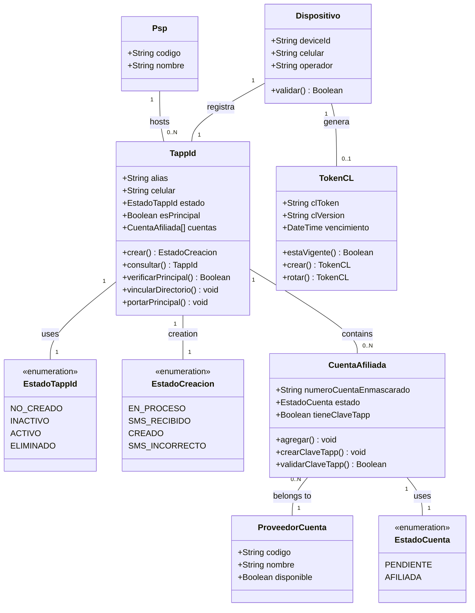

# **Diagrama de Clase — TAPP Onboarding**

Dominio del onboarding **visto por Interbank**. No hay código ni contrato todavía: las clases salen de las capturas de la sesión (12-nov) y de las grabaciones. Los atributos son nombres de dominio, no campos de contrato; se reemplazan cuando llegue el contrato de Izipay. Las operaciones indican el servicio de Izipay que las ejecuta según las capturas.



| Elemento | Fuente | Confirmado | Pendiente |
|---|---|---|---|
| `TappId` | Partes 1 y 3; parte 4 13:31 (`QueryVPAsReq`: alias, estado, cuentas, principal) | Nace `INACTIVO`; pasa a `ACTIVO` con la primera cuenta | Transiciones a `ELIMINADO` y regreso a `INACTIVO` (P8) |
| `crear()` | Parte 6 07:38–08:36; captura de creación | `ValidateDeviceDetailsReq`, devuelve `EstadoCreacion` | Estados intermedios (P3) |
| `consultar()` | Captura post-login, paso 6 | `QueryVPAsReq` | — |
| `verificarPrincipal()`, `vincularDirectorio()`, `portarPrincipal()` | Parte 6 25:30–32:35; captura de afiliación, pasos 7 a 10 | `getMapperAddressListReq` (CHECK, PORT) y `createMapperReq` (ADD, MODIFY). Solo con la primera cuenta | ADD falta en la captura (P2) |
| `Dispositivo.validar()` | Captura post-login, paso 1; creación, paso 2.4 | `QueryDeviceDetailsReq` | Tope de intentos (P7) |
| `TokenCL` | Parte 4 24:40–25:43; parte 6 00:00–03:49 | 30 días; se rota si cambia `clVersion`; por dispositivo | Alcance (P5) y persistencia (P34) |
| `CuentaAfiliada.agregar()` | Parte 6 19:05–20:22 | `AddAccountReq` la deja `PENDIENTE` | Limpieza de pendientes (P4) |
| `crearClaveTapp()`, `validarClaveTapp()` | Parte 6 20:48–23:32 | Clave de 6 dígitos; la valida el proveedor de cuentas | Servicio exacto: `UpiPinReq` o `BalEnqReq` (P2) |
| Cardinalidad `0..N` de cuentas | Partes 1 y 3 (modo calle) | En modo calle, una sola cuenta | Máximo fuera de modo calle (P28) |
| `Psp`, `ProveedorCuenta` | Parte 4 11:06–13:27 | Listas cacheadas, TTL 1 h | Atributos reales del contrato |
| `Psp` hosts `TappId` | Parte 4 03:53–04:17 | El alias `@interbank` vive en el tenant de Interbank dentro de Izipay (multi-tenant) | — |

-----------------
-----------------

# **Redis:**

```text
┌──────────────────────────────────────────────────────────────┐
│                 Caché: listas del ecosistema                 │
│                 Dueño: canal (Redis reutilizado)             │
│                 TTL: 1 hora                                  │
├──────────────────────────────────────────────────────────────┤
│ listaPsp: array[Psp]                                         │
│   └─ [0]: Psp                                                │
│       ├─ codigo: string                                      │
│       └─ nombre: string                                      │
├──────────────────────────────────────────────────────────────┤
│ listaProveedoresCuenta: array[ProveedorCuenta]               │
│   └─ [0]: ProveedorCuenta                                    │
│       ├─ codigo: string                                      │
│       ├─ nombre: string                                      │
│       └─ disponible: boolean     // modo calle               │
├──────────────────────────────────────────────────────────────┤
│ Clave de caché: por confirmar                                │
│ Origen: ReqListPsp y ReqListAccPvd (Izipay, 1 vez al día)    │
└──────────────────────────────────────────────────────────────┘
```

-----------------
-----------------

# **BD del canal (token CL):**

```text
┌──────────────────────────────────────────────────────────────┐
│                 Almacén: por confirmar (P34)                 │
│                 Clave: por confirmar (usuario y dispositivo) │
├──────────────────────────────────────────────────────────────┤
│ deviceId: string                                             │
│ clToken: string            // cifrado, llaves elípticas      │
│ clVersion: string                                            │
│ vencimiento: datetime      // creación + 30 días             │
└──────────────────────────────────────────────────────────────┘
```

Fuente: “vamos a tener que guardarlo en una BD del canal”, cifrado “con las llaves actualmente utilizadas” (parte 4, 24:40–25:43; parte 6, 00:59–01:14).

-----------------
-----------------

# **Datos que no persiste Interbank**

| Dato | Dónde vive | Nota |
|---|---|---|
| Tapp ID, cuentas afiliadas, estados | Base de Izipay | No documentado; Interbank lo consulta con `QueryVPAsReq` |
| Directorio (celular → Tapp ID principal) | BCRP | Se consulta y modifica por Izipay |
| Seis últimos de la tarjeta, vencimiento, clave de cajero, OTP | No se persisten (por confirmar, P23) | Solo viajan hacia Izipay |
