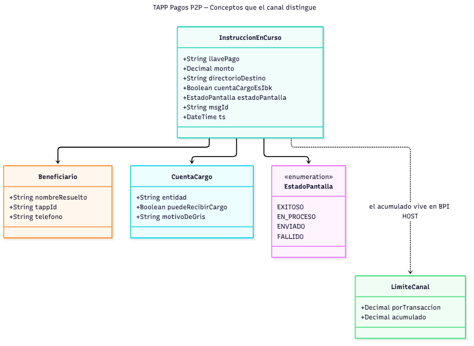

# Modelo de datos — instrucción de pago P2P

**26-nov-2026.** Conceptos que el canal distingue mientras instruye el pago. No hay esquema físico ni contrato de campos. Los atributos son nombres de dominio.

Fuente: [documento-tpap-pagos.md](documento-tpap-pagos.md) y [explicacion-malena.md](explicacion-malena.md). El dibujo está en [modelo-datos.mmd](modelo-datos.mmd).

## Qué significa cada pieza

| Pieza | Qué está cerrado | Qué no se dibuja como hecho |
|---|---|---|
| `InstruccionEnCurso` | El backend la retiene al recibir el `PaymentRequest`. Si el cliente cierra la app, el callback igual completa constancia, evidencia y post mortem | En qué base o caché se retiene |
| `Beneficiario` | Lo resuelve el PAC. Con TAPP ID o QR ya viene identificado. Con teléfono, después de elegir directorio | El campo del QR que dice si lo generó TAPP |
| `DirectorioDestino` | Solo existe si la llave fue teléfono o contacto. Elegir TAPP es TAPP a TAPP. Elegir otro es TAPP hacia fuera, y lo resuelve el PAC | — |
| `CuentaCargo` | Sale del home: cuentas afiliadas cruzadas con la consulta integrada. Trae la entidad. En gris si está inactiva, bloqueada, sin saldo o en modo calle | En qué momento del app vive cada uno de esos datos |
| `EstadoPantalla` | `exitoso` si el callback llega a tiempo y el pago salió. `en proceso` si el PAC responde eso. `enviado` si vence el timeout del canal. `fallido` pinta solo el error, sin referencia | El número del timeout. El nombre de la operación del callback |
| `LimiteCanal` | Por transacción: S/ 500, en el canal, antes de elegir cuenta. Acumulado: BPI HOST, antes de `PaymentRequest`. Son dos controles | Si el S/ 500 también vive en el PAC o en el proveedor de cuentas |

## Qué no entra al modelo persistido

Clave Tapp, OTP y PAN. La clave la captura la Common Library y viaja en `PaymentRequest`. El canal no la guarda. El PAN que PRE MONITOR pide a TRJ no cruza al app.

El favorito no es una entidad de este pago. Vive en la aplicación de favoritos de One App. Aquí solo se consulta el tope para mostrar o ocultar el botón.

La cuenta, el Tapp ID y el directorio los consulta el canal. La base de Izipay y la del BCRP no se modelan.
