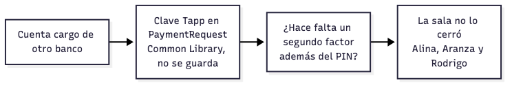
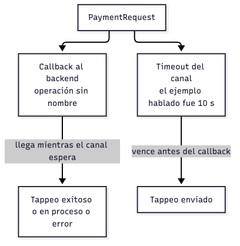
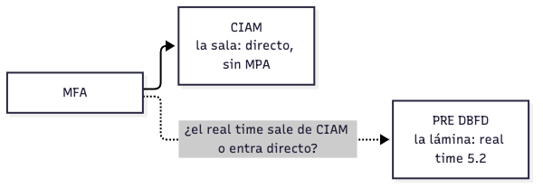
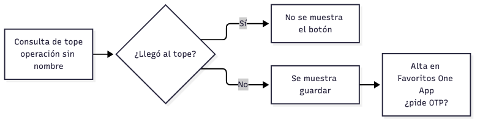
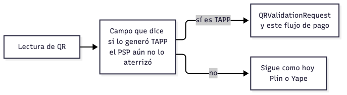

# Pendientes por cerrar — pagos P2P

**Interbank · 26-nov-2026**

Acompaña los diagramas de esta carpeta. Cada punto es algo que el PDF o la sala nombran y no cierran. En los dibujos quedó punteado, o se usó el comportamiento ya dicho mientras llega el nombre del servicio.

Cerrar un punto cambia una flecha de punteada a sólida, o le pone el contrato que hoy no tiene. No cambia el alcance: la instrucción del pago desde el APP Personas.

Las historias de usuario todavía no llegan. Cuando lleguen, se toca el diagrama del paso que la historia contradiga. No se reabre lo que la sala ya cerró y la historia no mencione.

| Punto | Quién lo cierra |
|---|---|
| 1. Segundo factor si la cuenta no es Interbank | Negocio. Alina, Aranza y Rodrigo |
| 2. Callback y timeout del canal | Técnico. Manuel García el patrón de red. Canal el número de segundos |
| 3. Quién dispara el real time | Técnico |
| 4. Favorito: operación y OTP | Los dos. Negocio dice si el alta pide OTP. Técnico nombra la operación en Favoritos |
| 5. Campo del QR TAPP | Técnico. PSP |
| 6. Momento de cada dato del cruce de cuentas | Canal. Luis |
| 7. Dónde retiene el backend el pedido en curso | Técnico |
| 8. Historial de una operación fallida | Fernando, con Izipay. Fuera de la pantalla de este pago |
| 9. Cuándo se consulta la lista de PSP | Canal. Roberto |
| 10. HMAC de la lámina 19 y firma XML | Técnico |

## 1. Segundo factor cuando la cuenta cargo no es Interbank

**Negocio.**

La lámina 13 y el mock piden la Clave Tapp. La sala confirma que se captura con la Common Library y que viaja en `PaymentRequest`. No hay otra API. La secuencia de cuenta externa dibuja solo eso.

Malena dejó abierta la lectura del reglamento SBS: autorizar una operación digital pide algo que la persona sabe y algo que tiene. Hoy el canal cubre eso con clave y con OTP. Con solo PIN puede faltar un factor. La nota manuscrita de la foto pregunta lo mismo.

Hasta que negocio responda, no se dibuja un OTP en esa rama.

## 2. Callback y timeout

**Técnico.**

El `PaymentRequest` se ve síncrono desde el canal. Por detrás el PAC trabaja asíncrono con el cargo, el abono y la CCE. La sala decidió que el PAC llama de vuelta al backend del app. Ese callback no estaba en el diseño original. Falta el nombre de la operación y el patrón de red. Manuel García es quien lo tiene.

El ecosistema puede tardar 45 segundos. El timeout del canal es menor. En la sala se usó diez segundos como ejemplo, no como número cerrado. Si vence, la pantalla dice «tappeo enviado» y no «exitoso». Si el PAC responde «en proceso», la pantalla dice en proceso. Si responde fallido, solo el mensaje de error.

Tampoco quedó dicho si un PIN rechazado vuelve en la respuesta de `PaymentRequest` o en el mismo callback. La secuencia de cuenta externa deja la validación dentro de esa llamada, que es lo que la sala dijo, y no parte la respuesta en dos mensajes.

## 3. Quién dispara el real time

**Técnico.**

Dos fuentes distintas:

- La lámina 18 manda el real time 5.2 a PRE DBFD, y el post mortem 5.3 por CIAM.
- La sala pide el MFA directo a CIAM, porque esta salida no lleva MPA, y dice que CIAM resuelve o envía las tramas real time.

La secuencia de cuenta Interbank dibuja las dos llamadas: MFA a CIAM y real time a PRE DBFD. La flecha que falta es si el real time lo origina CIAM o el backend.

El post mortem no está en duda. Sale si el real time rechaza, y también al cierre cuando ya se conoce éxito o falla.

## 4. Favorito en la constancia

**Los dos.**

Consultar el tope y crear el favorito van contra la aplicación de favoritos de One App. Si la persona ya llegó al tope, el botón no se muestra. La regla de la zona TAPP no es de este entregable.

No hay nombre de operación para la consulta ni para el alta. Y nadie respondió si guardar el favorito pide OTP. IBEX no contestó en la sala.

## 5. Campo del QR

**Técnico.**

Leer un QR debe abrir este flujo solo si el QR lo generó TAPP, igual que hoy se distingue un QR de Plin o de Yape. Malena dice que el PSP todavía no aterrizó el campo de la trama. `QRValidationRequest` sí está nombrado. El campo, no.

## 6. Cruce de cuentas en gris

**Canal.**

La regla está cerrada y por eso la secuencia la dibuja en sólido. El backend cruza la consulta integrada del home con las cuentas que el PAC afilió al TAPP ID. Una cuenta va en gris si está inactiva, bloqueada, sin saldo o en modo calle. El modo calle lo resuelve el app.

Lo que falta es el momento. Luis tiene el detalle de en qué punto del app ya están el saldo, el bloqueo y el modo calle. Hasta esa nota, el cruce se dibuja como una sola acción del backend al armar la lista.

## 7. Almacén del pedido en curso

**Técnico.**

El backend retiene la instrucción para poder terminar constancia, evidencia y post mortem aunque el cliente cierre la app. La sala lo dijo como comportamiento. No dijo tabla, caché ni tiempo de vida. En el modelo queda como concepto, sin caja de persistencia.

## 8. Fallida en el historial

**Fernando, con Izipay.** Fuera de la pantalla de este pago.

En la operación, un fallido del PAC muestra solo el error. No se arma constancia ni se muestra referencia. Si ese movimiento aparece después en el historial, y con qué datos, es el caso de uso de consulta que ve Fernando. Hay otro estado, distinto de fallido, que la sala dejó en la conciliación: pudo haber cargo y no abono.

## 9. Lista de PSP para el buscador

**Canal.**

No es un paso del pago. Quedó en la misma sesión. En el buscador general no se busca por TAPP ID. Se puede armar el alias con arroba y la lista de PSP, y al toque entrar a la zona, solo si la persona ya está afiliada. Esa lista se consulta una vez al día y antes de entrar a TAPP, porque también la usa la pantalla de Plin. Saber si un teléfono está en el directorio TAPP es `contactSwipeRequest`. El momento exacto de la consulta de PSP quedó con Roberto.

## 10. HMAC y firma XML

**Técnico.**

La lámina 19 pide HMAC para la integridad de los datos. El marco del BCRP pide firma XML con la Common Library, y la sala usa esa librería para capturar la Clave Tapp y firmar. Son dos mecanismos. Falta decir cuál cubre el mensaje UPI y cuál, si alguno, cubre otra integración del canal. Los diagramas usan la Common Library, que es lo que la sala operó. No dibujan un HMAC hasta que alguien lo asigne.

## Huecos de fuente

No mueven flechas. Evitan dar por leída una página que no está.

- La página 21 de `TPAP - Pagos.pdf` no está en las fotos. La 20 es el cierre.
- El marco de seguridad declara 32 páginas. Las fotos son 29. Faltan la carátula y un tramo entre los criterios de excepción y el Anexo 2.
- El cuerpo del marco y los anexos no numeran las mismas secciones. La transcripción deja las dos numeraciones.
