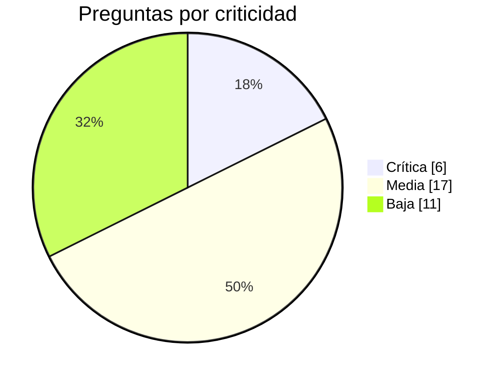

# TAPP Onboarding — Preguntas abiertas para la presentación

**Interbank · 23-nov-2026**
Resumen de [ronda-preguntas-1.md](ronda-preguntas-1.md) (P1 a P34) ordenado por criticidad. El detalle, las fuentes y el registro de respuestas siguen en ese archivo.

**Criterio**

| Nivel | Significa |
|---|---|
| 🔴 **Crítica** | Bloquea un diagrama o es un riesgo regulatorio o de seguridad. Sin respuesta no se aprueba la arquitectura |
| 🟠 **Media** | Cambia el diseño o el manejo de errores. Se dibuja con "por confirmar" |
| 🟢 **Baja** | No cambia los diagramas, o ya se respondió en la sesión y falta confirmarlo por escrito |

---

## 🔴 Críticas (6)

| # | Pregunta | A quién | Qué bloquea |
|---|---|---|---|
| P11 | ¿Qué validaciones corren al entrar a la zona TAPP y cuáles antes (por ejemplo, el token CL)? | José (decisión de arquitectura) | Dónde empieza el post-login y cuánto espera el cliente |
| P33 | ¿Qué servicios resuelve Izipay en su base, cuáles salen al UPI Switch y cuáles van directo al proveedor de cuentas de Interbank (on-us)? | Izipay | Las flechas hacia el switch en los tres diagramas |
| P2 | En la captura, crear clave usa `BalEnqReq` y validar `UpiPinReq`; el audio dice lo contrario. ¿Cuál es? ¿El paso 8 lleva `ADD`? | Izipay | Pasos 5, 6 y 8 de la afiliación |
| P34 | ¿El token CL se persiste en una BD del canal, en el dispositivo o en ambos? ¿Qué base y con qué clave? | Canal y backend | El almacén de datos del post-login |
| P22 | En afiliación y alias solo hay registro de evidencia, sin factor. ¿Cumple el reglamento de canales digitales (algo que sabe y algo que tiene)? | Ciberseguridad (Jaime), Aranza | Aprobación regulatoria del flujo |
| P23 | Tarjeta, clave de cajero y OTP pasan por el backend de Azure. ¿Entra en alcance PCI o viajan cifrados del SDK a Izipay? ¿Qué pide la sección TPAP del BCRP? | Ciberseguridad | Alcance PCI y aprobación de seguridad |

## 🟠 Medias (17)

| # | Pregunta | A quién |
|---|---|---|
| P3 | Si `ValidateDeviceDetailsReq` es síncrona, ¿puede volver "en proceso" o "SMS recibido"? ¿Qué hace el backend? | Izipay |
| P4 | ¿Cuándo se limpian las cuentas pendientes de `AddAccountReq` y qué pasa si el cliente reintenta? | Izipay |
| P5 | ¿El token CL es por dispositivo? ¿30 días? ¿`ListKeys` una vez al día? | Izipay |
| P7 | ¿Cuántos intentos bloquean el onboarding y se pueden configurar? (24 h es la espera) | Izipay |
| P8 | ¿Un Tapp ID eliminado se recrea? ¿Vuelve a inactivo al desafiliar la última cuenta? | Izipay |
| P10 | ¿Qué timeout garantiza Izipay por servicio? (se oyó 3 y 8 s) | Izipay |
| P12 | Si falla el post-mortem después de que Izipay y el BCRP confirmaron, ¿reintento, cola o alerta? | Canal y backend |
| P13 | Tras actualizar el celular, ¿retoma o reinicia? ¿Hay tope de intentos? | Canal y backend |
| P16 | iOS: ¿cómo sabe el app que el SMS salió de Mensajes? ¿Largo del token? | Canal |
| P17 | Android: ¿plan para el permiso de envío de SMS? | Canal |
| P18 | ¿Qué campos de la consulta integrada viajan en sesión (bloqueo, tarjeta)? | Canal y backend |
| P21 | ¿La detección de root/jailbreak de SMP aplica a TAPP y en qué paso? | Seguridad |
| P24 | ¿La aceptación de TyC va a LTD con entrega garantizada? | Seguridad |
| P25 | ¿Quién prende y apaga la disponibilidad del banco (modo calle)? | Producto |
| P26 | Cuenta bloqueada: ¿puede elegir otra o sale del flujo? | Producto |
| P27 | Tarjeta digital: ¿subflujo o flujo aparte? ¿Quién la emite? | Producto |
| P28 | Fuera de modo calle, ¿cuántas cuentas por Tapp ID? | Producto |

## 🟢 Bajas (11)

| # | Tema | Estado |
|---|---|---|
| P1 | El directorio solo se toca al afiliar la primera cuenta | Respondida en la sesión; confirmar con Izipay |
| P6 | Nadie avisa al banco anterior; la portabilidad es síncrona | Respondida en la sesión |
| P14 | Réplica de cuentas en el paso 2, por API interno | Respondida; falta el nombre del API |
| P15 | Aviso "no eres el principal": cintillo y burbuja | Respondida; falta el texto |
| P19 | Redis reutilizado | Respondida |
| P20 | Notificación de creación por correo tras crear el Tapp ID | Respondida; falta el componente |
| P31 | Solo clientes de Interbank, sin fecha para no clientes | Respondida |
| P9 | Frecuencia de cambio de listas de PSP y aviso de participante nuevo | Pendiente |
| P29 | Texto de la constancia de creación (con Andrea) | Pendiente |
| P30 | OTP que no llega o expira | Pendiente |
| P32 | "Autorización de solicitud", BFA/OTP vs SIAM y TCC en las láminas | Pendiente |

---

## Pedido de cierre

1. **Izipay:** P2, P33 (críticas), más P3, P4, P5, P7, P8, P10. Pedir además **volumetría** y el **contrato** (OpenAPI o equivalente).
2. **José:** decidir P11 y dejarla como ADR.
3. **Ciberseguridad (Jaime) y Aranza:** P22 y P23 en paralelo, antes de la aprobación.
4. **Canal y backend:** P34 y las medias de su lado.
